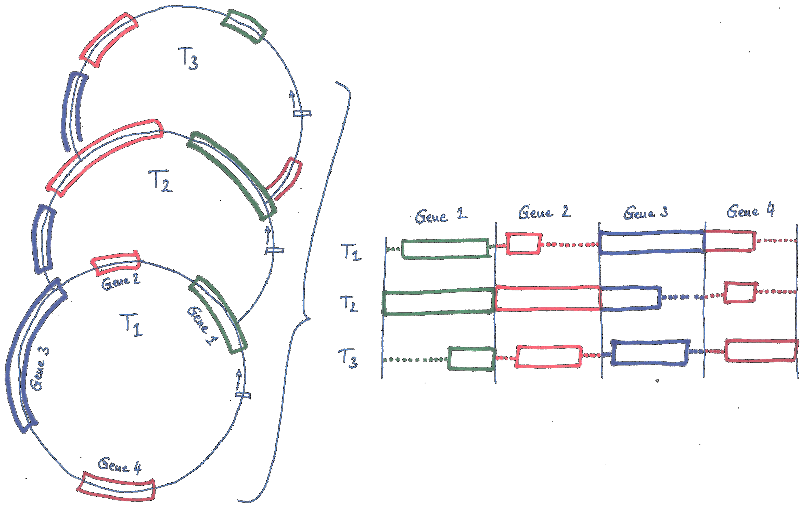

# PlastBurstAlign
Python tool for extracting and aligning genes, introns, and intergenic spacers across thousands of plastid genomes.

---

### Purpose
PlastBurstAlign supports large-scale quality assessment of organellar genome annotations. It detects discrepancies by comparing sequence and annotation features across homologous regions with automated multiple sequence alignments.

### Overview of process


### Features
- Extracts, groups, and aligns genes (`cds`), introns (`int`), intergenic spacers (`igs`), and tRNAs/rRNAs (`rna`; nucleotide-only alignment).
- Aligns each marker group by mode: protein alignment and nucleotide back-translation for CDS, and direct nucleotide alignment otherwise. Supports MAFFT, MUSCLE, and Clustal Omega, plus configurable generic and custom command-line aligners.
- Splices cis-spliced exons in place and groups and repositions trans-spliced exons (e.g., _rps12_) before merging.
- Trims one or two trailing bases from CDS sequences whose length is not divisible by three if they start with `ATG`; skips other such sequences without validating start or stop codons.
- Standardizes tRNA and rRNA names, and deduplicates regions by normalized name, retaining at most one copy per genome. For intergenic spacers, checks reverse-flanking-gene names to identify IR-mirrored duplicates.
- Filters user-selected regions and regions below minimum sequence-length or taxon-representation thresholds.
- Concatenates successful alignments alphabetically or by genomic position in the first genome processed.
- Parallelizes extraction and marker alignment, and logs progress, warnings, failures, and extraction problems; verbose mode adds diagnostics.

---

### Input/output
#### Input
- Set of complete plastid genomes (each in GenBank flatfile format)
#### Output
- DNA sequence alignments of individual genome regions (FASTA and NEXUS formats)
- Concatenation of all individual DNA sequence alignments (FASTA and NEXUS format)

### Installation on Linux (Debian)
PlastBurstAlign requires Python 3.11 or later. To install it from PyPI:

```bash
python -m pip install plastburstalign
```

At least one supported external alignment tool (MAFFT, MUSCLE, or Clustal Omega) must also be installed. If the selected tool's executable is not on `PATH`, provide its path with `--alignmenttoolpath`.

#### Option 1 — Conda environment (recommended)
The Conda environment installs the Python dependencies and all three supported alignment tools. Install PlastBurstAlign itself from the cloned repository after activating the environment:

```bash
git clone https://github.com/michaelgruenstaeudl/PlastBurstAlign.git
cd PlastBurstAlign
conda env create -f environment.yml
conda activate plastburstalign
python -m pip install .
```

#### Option 2 — Install the alignment tools manually on Debian
```bash
sudo apt install mafft muscle clustalo
```

### Source usage
If you cloned the repository:

```bash
git clone https://github.com/michaelgruenstaeudl/PlastBurstAlign.git
cd PlastBurstAlign
python -m plastburstalign
```

---

### Usage

#### Command-line (recommended)
After installation via `pip`, run:

```bash
plastburstalign
```
##### Example run

```bash
plastburstalign \
  -i Input_dataset \
  -o Output_dataset \
  -s cds \
  -a mafft
```

#### Python API

Use the package directly in Python:

```python
from plastburstalign import PlastBurstAlign
burst = PlastBurstAlign()
burst.execute()
```

##### Usage of individual package components
Individual components are also available. For example, instantiate MAFFT with different thread settings:

```python
from plastburstalign import MAFFT, MUSCLE, ClustalOmega
mafft = MAFFT({"alignment_tool_config": {"threads": 4}})
muscle = MUSCLE()
clustal = ClustalOmega()
```

---

### Parameters overview

| Option | Description | Example |
|--------|-------------|---------|
| `-i` | Input dataset directory | `-i Input_dataset` |
| `-o` | Output directory | `-o Output_dataset` |
| `-s` | Sequence type to extract (`cds`, `int`, `igs`, or `rna`) | `-s cds` |
| `-a` | Alignment tool to use | `-a mafft` |
| `-l` | Minimum sequence length (bp); regions shorter than this are excluded| `-l 9` |
| `-t` | Minimum number of taxa (int) or relative frequency (0<value<=1) in which a region must be present to be extracted | `-t 0.1` |
| `-n` | Number of parallel workers for extraction and marker alignment (default: `auto`) | `-n 8` |
| `--trna` | Include tRNAs in `rna` mode (disabled unless specified) | `--trna` |
| `--rrna` | Include rRNAs in `rna` mode (disabled unless specified) | `--rrna` |
| `--config` | Path to YAML config file containing parameters | `--config config.yaml` |

---

### Example usage

#### Install from a local checkout

From the repository root, install the package and its Python dependencies into
the active environment:

```bash
python -m pip install .
```

PlastBurstAlign also requires an external alignment program. Install MAFFT,
MUSCLE, or Clustal Omega separately and make its executable available on `PATH`,
or provide its path with `--alignmenttoolpath`.

#### Prepare input data

Put the input plastid genome GenBank flatfiles in a directory. The default
extension is `.gb`; use `--fileext` (or `-f`) if your files use another
extension. For example:

```text
Input_dataset/
  genome_1.gb
  genome_2.gb
```

#### Run from the command line

The installed command and `python -m plastburstalign` accept the same options.
This example extracts coding regions and aligns them with MAFFT:

```bash
plastburstalign -i Input_dataset -o Output_CDS -s cds -a mafft
```

The output directory is created if it does not exist. The main selection modes
are:

| Mode | Regions |
|------|---------|
| `cds` | Coding sequences |
| `int` | Introns |
| `igs` | Intergenic spacers |
| `rna` | Annotated tRNAs and rRNAs, aligned as nucleotides |

Use a separate output directory for each run if you want to keep its results
separate. For example, to align tRNAs and rRNAs:

```bash
plastburstalign -i Input_dataset -o Output_RNA -s rna --trna --rrna -a mafft
```

RNA types are disabled by default in the command line. Pass `--trna` and
`--rrna` to include both, or pass only one switch to extract only that type.
At least one type must be enabled. For example:

```bash
# tRNAs only
plastburstalign -i Input_dataset -o Output_tRNA -s rna --trna -a mafft
# rRNAs only
plastburstalign -i Input_dataset -o Output_rRNA -s rna --rrna -a mafft
```

RNA features are aligned directly as nucleotide sequences; joined feature parts
are concatenated in strand-correct order, omitting intervening introns.

Common options include:

| Option | Description | Example |
|--------|-------------|---------|
| `-i`, `--inpd` | Input directory containing GenBank files | `-i Input_dataset` |
| `-o`, `--outd` | Output directory | `-o Output_CDS` |
| `-s`, `--selectmode` | Region type: `cds`, `int`, `igs`, or `rna` | `-s igs` |
| `-a`, `--alignmenttool` | Alignment program: `mafft`, `muscle`, or `clustal` | `-a mafft` |
| `--alignmenttoolpath` | Path to the alignment executable when it is not on `PATH` | `--alignmenttoolpath /path/to/mafft` |
| `-f`, `--fileext` | Input file extension (default: `.gb`) | `-f .gbk` |
| `-l`, `--minseqlength` | Minimum region length in base pairs | `-l 9` |
| `-t`, `--minnumtaxa` | Minimum number of taxa, or a relative frequency from 0 to 1 | `-t 0.1` |
| `-n`, `--numthreads` | Number of CPUs to use, or `auto` | `-n 8` |
| `-c`, `--concat` | Also write a concatenation of successful alignments | `-c` |
| `--config` | Path to a YAML configuration file | `--config config.yaml` |
| `--trna` | Include tRNAs in RNA mode (disabled unless specified) | `--trna` |
| `--rrna` | Include rRNAs in RNA mode (disabled unless specified) | `--rrna` |

Run `plastburstalign --help` for the full list of command-line options. YAML
configuration keys use the parameter names shown in `config.yaml`, such as
`in_dir`, `out_dir`, `select_mode`, and `alignment_tool`. In CLI runs, pass
`--trna` and/or `--rrna` explicitly for RNA mode; these switches default to
disabled and override the corresponding YAML values.

#### Output files

Unaligned nucleotide FASTA files are written directly to the output directory.
For coding regions, unaligned protein FASTA files and intermediate protein
alignments are also written there. Aligned nucleotide FASTA files are placed in
`fasta/`, and their NEXUS conversions are placed in `nexus/`. With `--concat`,
the concatenated FASTA and NEXUS files are written directly to the output
directory. PlastBurstAlign creates these output folders as needed; there is no
need to create or move them manually.

---

#### Python API

The package can also be run from Python by supplying a `UserParameters`
instance:

```python
from plastburstalign import PlastBurstAlign, UserParameters

params = UserParameters(
    in_dir="Input_dataset",
    out_dir="Output_CDS",
    select_mode="cds",
    alignment_tool="mafft",
)
PlastBurstAlign(params).execute()
```

---

### Benchmarking
```bash
cd benchmarking
# CDS
python benchmarking_CDS.py benchmark_YangEtAl2022_Asteraceae 5
# INT
python benchmarking_INT.py benchmark_YangEtAl2022_Asteraceae 5
# IGS
python benchmarking_IGS.py benchmark_YangEtAl2022_Asteraceae 5
```
- Dataset `benchmark_ZhangNNEtAl2025_53angiosperms`: the same 53-angiosperm dataset used by [Zhang et al. 2025](https://doi.org/10.1016/j.pld.2025.05.005).
- Datasets `benchmark_YangEtAl2022_Asteraceae.tar.gz`, `benchmark_YangEtAl2022_monocots`, and `benchmark_YangEtAl2022_angiosperms`: all Asteraceae (n=155), monocots (n=733), and angiosperms (n=2,585), respectively, listed by [Yang et al. 2022](https://www.frontiersin.org/journals/plant-science/articles/10.3389/fpls.2022.808156).
- Dataset `benchmark_ZhangNNEtAl2025_13724angiosperms`: 13,724 rather than 13,731 angiosperms from [Zhang et al. 2025](https://doi.org/10.1016/j.pld.2025.05.005). It excludes records removed from NCBI RefSeq during standard annotation processing: AC_000188, NC_029253, NC_029254, NC_029331, NC_029333, NC_071962, and NC_085618.

#### Setting up benchmark
```bash
apt install ncbi-entrez-direct  # on Debian
cd benchmarking1
while read accn; do
  efetch -db nucleotide -id $accn -format gb > ${accn}.gb 2>>log.txt;
done <Accession_numbers_Asteraceae_YangEtAl2022.txt  # doi: 10.3389/fpls.2022.808156
```

#### Run the benchmarking script

The repository includes [`benchmarking/test_script.py`](../benchmarking/test_script.py)
to run PlastBurstAlign once on a dataset with a chosen thread count and selection
mode. First, place or unpack the GenBank dataset in a directory under
`benchmarking/` (for example, `benchmarking/benchmarking1/`). From the
repository root, run:

```bash
python benchmarking/test_script.py benchmarking1 8 cds
```

The positional arguments are the dataset directory, number of CPUs, and
selection mode (`cds`, `int`, `igs`, or `rna`), in that order. A relative
dataset path is resolved from the `benchmarking/` directory; an absolute path
can also be supplied. The script runs `python -m plastburstalign` and writes
results under `benchmarking/` in a directory named
`<dataset-name>_output_<mode>_<threads>threads` under `benchmarking/`. For
example, the command above writes to
`benchmarking/benchmarking1_output_cds_8threads/`.

Install the package dependencies and an external alignment program before
running the benchmark. The script imports Python's `resource` module, so run it
on Linux or macOS (or in a compatible Unix-like environment such as WSL); it
does not run as-is on native Windows Python.

---

### Explanations

#### Marker-wise alignment and filtering

Each run selects one extraction mode. PlastBurstAlign groups regions by marker name and aligns each group independently. In `cds` mode, it aligns translated amino-acid sequences and back-translates the alignment to nucleotides; `int`, `igs`, and `rna` modes align nucleotides directly.

The `-n` option controls concurrent extraction and marker-alignment workers. MAFFT and Clustal Omega also accept a separate per-alignment thread count in `alignment_tool_config` (default: 1); the built-in MUSCLE wrapper does not set a thread count. Generic and custom aligners use the thread options supplied in their configuration or command.

The minimum sequence length is applied during extraction; a cleanup step also removes any marker group whose longest extracted sequence is below the threshold. The minimum taxon threshold is applied after extraction and accepts either an absolute count (integer) or a relative proportion (`0 < value <= 1`) of input files. User-selected exclusions are removed before MSA. When `--concat` is enabled, successful marker alignments are concatenated in both FASTA and NEXUS formats, alphabetically or by feature order in the first genome processed.

#### Extracting tRNAs and rRNAs

Use `-s rna` (or `select_mode: "rna"` in YAML) to extract and align annotated
`tRNA` and `rRNA` features as nucleotide sequences:

```bash
plastburstalign -i Input_dataset -o Output_RNA -s rna --trna --rrna -a mafft
```

RNA types are disabled by default in the CLI. Use both switches to include both
types, or one switch to include only that type:

```bash
# tRNAs only
plastburstalign -i Input_dataset -o Output_tRNA -s rna --trna -a mafft
# rRNAs only
plastburstalign -i Input_dataset -o Output_rRNA -s rna --rrna -a mafft
```

The Python API parameters `include_trna` and `include_rrna` both default to `false`. In CLI runs, `--trna` and `--rrna` override YAML values. Because both switches default to disabled, pass at least one in RNA mode; otherwise the run reports an error. These switches do not affect `cds`, `int`, or `igs`.

RNA mode does not translate sequences, require start/stop codons, or trim sequences to a multiple of three. It extracts annotated parts in strand-correct order; joined features have their exons concatenated and intervening introns omitted. Features must have a `gene` qualifier. Gene-name normalization, duplicate removal per genome, minimum-length and taxon filters, ordering, exclusions (`--exclcds` or `--exclreg`), and optional concatenation all apply. Output uses the existing nucleotide `nucl_` FASTA and NEXUS formats, with no protein files. The `cds`, `int`, and `igs` modes are unchanged.

#### Details on exon splicing
Many plastid genes contain multiple exons, which must be joined before amino-acid-based alignment. PlastBurstAlign distinguishes cis-spliced genes, whose exons are adjacent, from trans-spliced genes, whose exons are not. It joins cis-spliced exons in place. For trans-spliced genes (e.g., _rps12_), it first merges adjacent or overlapping exons with the same gene name, then joins those groups at the first exon's position.

#### Details on removal of user-specified genome regions from alignment
Because regions are difficult to remove from a concatenated alignment, user-specified exclusions must be applied before sequence alignment. `exclude_region` removes exact region-name matches. `exclude_fullcds` removes specified genes, any introns within them, and intergenic spacers immediately adjacent to them.

#### Details on automatic standardization of tRNA and rRNA gene names
tRNA annotations vary in case and delimiters, and may include both an amino-acid abbreviation and anticodon (`trnA-Leu-UAA`), only an anticodon (`trnA-UAA`), or lowercase anticodons (`trnA-uaa`).

To group tRNAs consistently, PlastBurstAlign standardizes names across input genomes to the `trnA_UAA` format (gene abbreviation plus anticodon). This common plastid naming format also avoids dashes, which aligners may treat as gap characters. Standardization uses INSDC [three-letter amino-acid abbreviations](https://www.insdc.org/submitting-standards/feature-table/#7.4.3) and [translation table 11 anticodon definitions](https://www.insdc.org/submitting-standards/genetic-code-tables/). Names such as `trnA`, with multiple possible anticodons and no disambiguating annotation, are left unchanged rather than guessed; possible designations include `trnA_UAA`, `trnA_CAA`, `trnA_AAG`, `trnA_GAG`, `trnA_UAG`, and `trnA_CAG`.

Recognized rRNA gene names and product labels are standardized to `rrn16`, `rrn23`, `rrn4.5`, or `rrn5`.