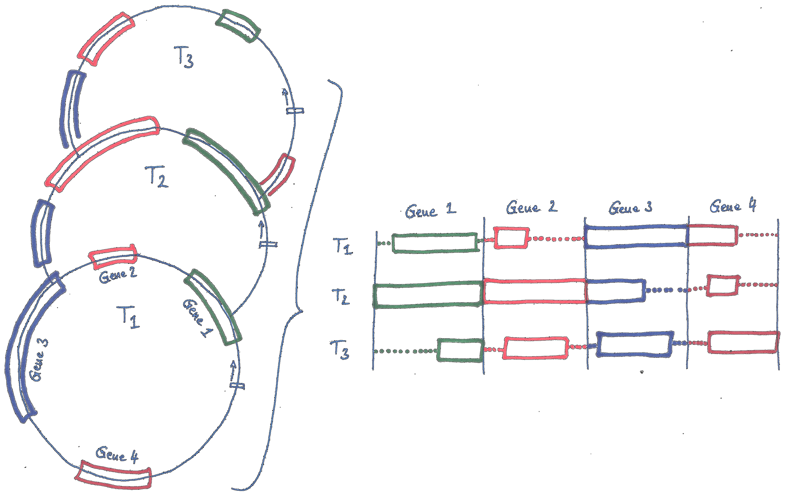

# PlastBurstAlign

[](https://github.com/michaelgruenstaeudl/PlastBurstAlign/actions/workflows/ci.yml)
[](https://www.astral.sh/ruff)
[](https://mypy-lang.org/)
[](https://opensource.org/licenses/BSD-3-Clause)

Extract and align genes, introns, and intergenic spacers across hundreds or thousands of plastid genomes—with bounded memory, deterministic strategy selection, and optional Slurm parallelism.

**Version:** `3.0.0rc1` (release candidate).

---

### Quick start

```python
import plastburstalign as pba

result = pba.align("Input_GBK", mode="cds", out_dir="Out_CDS", seed=1)
print(result.summary())
```

CLI (after `conda env create -f environment.yml && conda activate plastburstalign` and `pip install -e .`):

```bash
plastburstalign -i Input_GBK -o Out_CDS -s cds -a mafft -c --seed 1
```

Same entry point via `pba` or `python -m plastburstalign`. Put GenBank flatfiles in `Input_GBK` (default extension `.gb`).

---

### Purpose

PlastBurstAlign builds multigenic MSAs from annotated plastomes: it extracts homologous regions, applies an appropriate nucleotide or protein alignment strategy, streams a dense supermatrix, and writes FASTA / NEXUS / partition files suitable for phylogenomics. It is also useful for large-scale annotation QC (missing or misplaced features show up as gaps or failed loci).



---

### What is new in v3

| Area | Behavior |
|------|----------|
| Strategy | Work model `N·L^α + β·N²·L`; tier choice is a pure function of the data (not core count). Provisional constants until calibration finishes—see [docs/calibration.md](docs/calibration.md). |
| Scheduler | CPU-set leases, memory admission, straggler promotion; optional anchor-based sub-locus chunking (`--subdivide`). |
| Data engine | Dense `uint8` matrices, vectorized site filters, streaming `SupermatrixBuilder`, codon-aware partitions. |
| Host / tools | `HostProfile` + `autotune` (workers, scratch tier, memory envelope); aligner resolver with built-in center-star fallback; `plastburstalign --doctor`. |
| Determinism | Same inputs + `--seed` → identical FASTA/NEXUS/partitions across repeats, thread counts (`--subdivide off`), and `PYTHONHASHSEED`. |
| Ops | Run manifest (`run_manifest.json`), PlastBench harness, golden parity gate, CI on Python 3.11–3.13. |

Hardware affects scheduling and scratch only. Opt-in `--time-budget` (when wired) is the only host-adaptive mode and is non-reproducible by design.

---

### Installation

**Conda (recommended)** — installs Python deps and aligner binaries:

```bash
git clone https://github.com/michaelgruenstaeudl/PlastBurstAlign.git
cd PlastBurstAlign
conda env create -f environment.yml
conda activate plastburstalign
pip install -e .
```

**Pip** (aligners must already be on `PATH`, or use the built-in fallback):

```bash
pip install plastburstalign
# optional system packages: mafft, muscle, clustalo
```

Requires Python ≥ 3.11. Dev extras: `pip install -e ".[dev]"`.

---

### CLI usage

```bash
# CDS with concatenation, fixed seed, site occupancy trim, RAxML+NEXUS partitions
plastburstalign -i Input_GBK -o Out_CDS -s cds -a mafft -c \
  --seed 1 --trim occupancy=0.5 --partitions raxml,nexus -n auto

# Disable sub-locus chunking (strict thread-invariant alignments)
plastburstalign -i Input_GBK -o Out_IGS -s igs -a mafft -c --subdivide off --seed 1

# Diagnose host, resolved aligners, and scratch recommendations
plastburstalign --doctor
```

| Flag | Role |
|------|------|
| `-s` / `--selectmode` | `cds`, `int`, `igs`, or `rna` |
| `-n` / `--numthreads` | Positive int or `auto` (usable physical cores) |
| `--trim` | `none`, `occupancy=<f>`, `entropy`, `informative-only`, `gappyout` |
| `--min-occupancy` | Adds / sets occupancy threshold |
| `--partitions` | `raxml`, `nexus`, `iqtree`, `partitionfinder`, or `none` |
| `--codon-partitions` | CDS codon-position partitions |
| `--subdivide` | `auto` (default), `off`, or `force` |
| `--keep-unaligned` / `--no-keep-unaligned` | Retain unaligned FASTA in `out_dir` |
| `--smt` / `--no-smt` | Include / exclude SMT siblings in the CPU budget |
| `--memory-limit` | Admission cap (e.g. `8G`) |
| `--seed` | MAFFT `--randomseed` for deterministic runs |
| `--phylip` | Also write relaxed PHYLIP concatenation |
| `--doctor` | Print host / aligner / scratch report and exit |
| `--estimate` | Pre-flight cost estimate after extract/clean; exit without aligning |
| `--dashboard` / `--no-dashboard` | Force rich live dashboard on/off (default: auto) |
| `--time-budget` | Opt-in stub; value recorded only (host-adaptive path not fully wired) |
| `--export-slurm` / `--align-partition` / `--finalize-slurm` | Slurm array workflow |

See `plastburstalign --help` and [docs/exemplary_usage.md](docs/exemplary_usage.md).

Modes: `cds` (protein-guided), `int`, `igs`, `rna` (tRNA+rRNA; use `--no-trna` / `--no-rrna` to restrict).

---

### Autotune, trimming, partitions

With `-n auto`, PlastBurstAlign profiles the host (cores, cgroup/Slurm limits, RAM, tmpfs) and builds a `TuningPlan`: worker count, per-task thread cap, scratch tier, and a memory envelope. The plan is logged at run start and recorded in `run_manifest.json`.

Trimming runs in-flight on dense locus matrices before concatenation. Partition writers emit RAxML-NG / IQ-TREE style blocks and NEXUS `charset` / `charpartition`; optional codon partitions track original column indices through trimming.

---

### Slurm

1. `plastburstalign -i … -o … -s … --export-slurm --slurm-partitions N …` writes array scripts and a `slurm_manifest.json`. Partition weights use the region work estimate (`N·L^α`), not file sizes.
2. Workers run `--align-partition K --manifest …` and export unaligned FASTA from the SQLite feature store into node-local scratch (no shared unaligned tree required).
3. `--finalize-slurm --manifest …` verifies partition outputs and builds the supermatrix.

Use `--scratch-dir` / `$SLURM_TMPDIR` for fast node-local I/O.

---

### Python API

Preferred entry point:

```python
import plastburstalign as pba

result = pba.align(
    "Input_GBK", mode="cds", out_dir="Out_CDS", seed=1, trim="occupancy=0.5"
)
print(result.summary())  # AlignmentResult: matrix, writers, run_manifest path
plan = pba.autotune(num_threads="auto")
est = pba.estimate("Input_GBK", mode="cds")
```

Lower-level `UserParameters` + `PlastBurstAlign` remains available for Slurm / custom sinks:

```python
from plastburstalign import PlastBurstAlign, UserParameters

params = UserParameters(
    in_dir="Input_GBK",
    out_dir="Out_CDS",
    select_mode="cds",
    alignment_tool="mafft",
    concat=True,
    seed=1,
    subdivide="off",
    trim="occupancy=0.5",
    num_threads="auto",
)
PlastBurstAlign(params).execute()
```

---

### Doctor and troubleshooting

```bash
plastburstalign --doctor
# or: plastburstalign --doctor --json
```

| Symptom | Check |
|---------|--------|
| `mafft: command not found` | Install MAFFT, set `--alignmenttoolpath` / `PBA_MAFFT`, or rely on the built-in aligner (slower; quality warning). `PBA_FORCE_BUILTIN_ALIGNER=1` forces the fallback. |
| OOM / thrashing | Lower `-n`, raise free RAM, or pass `--memory-limit`; prefer tmpfs scratch (`--doctor` shows the tier). |
| Non-identical repeats | Pass `--seed`; use `--subdivide off` when comparing across thread counts. |
| Empty / tiny matrices | Relax `-t` / `-l`; inspect failed loci in logs and `run_manifest.json`. |
| Slurm workers fail | Ensure the feature store and `--manifest` path are visible; workers do not need `-i` / `-s` when the store is populated. |
| Strategy looks too aggressive | Constants may still be provisional—see [docs/calibration.md](docs/calibration.md). |

More examples: [docs/exemplary_usage.md](docs/exemplary_usage.md). Benchmarking data: [docs/generating_benchmarking_data.md](docs/generating_benchmarking_data.md).

---

### Development

```bash
pip install -e ".[dev]"
ruff check plastburstalign tests
ruff format --check plastburstalign tests
mypy plastburstalign
python -m pytest -q tests
```

See [CONTRIBUTING.md](CONTRIBUTING.md), [CHANGELOG.md](CHANGELOG.md), and [CITATION.cff](CITATION.cff). License: BSD-3-Clause ([LICENSE](LICENSE)).
